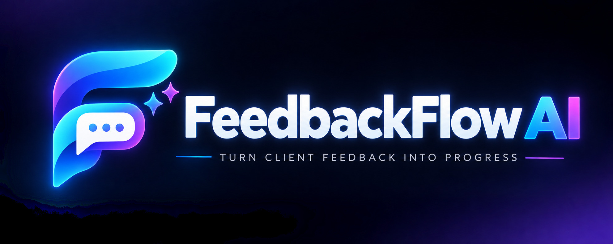

# FeedbackFlow AI — The AI Revision Resolver

<p align="center">
  
</p>

**FeedbackFlow AI** turns scattered client revision comments into a prioritized, traceable queue. It classifies feedback, suggests duplicate groups, flags conflicting instructions, keeps source comments attached to each task, and records approval decisions. TinyFish Fetch retrieves public website content so the analysis can consider the site's current context.

> AI outputs are suggestions. Users confirm duplicate merges and resolve conflicts. Normal application code—not the LLM—enforces task status transitions and writes approval events.

## Features in this implementation

- **Persistent dark/light mode** with an ambient navy, cyan, violet, and teal dark theme.
- **Project workspaces** with client name and website URL.
- **Bulk feedback import** from pasted chat, email, or meeting notes. Separate comments with blank lines or `---`; repeated text imports are skipped.
- **AI classification and extraction**: actionable request, question, opinion, priority, normalized wording, and clarification note. OpenAI uses schema-constrained responses + Zod validation when configured.
- **Duplicate detection**: `text-embedding-3-small` candidate retrieval where available, pair-level LLM confirmation, and a deterministic demo fallback. Suggested groups are never merged without a user decision. Group creation avoids transitive over-merging by requiring pairwise compatibility.
- **Conflict and change-of-mind review** with source comments, explanation, Follow A / Follow B / Ask client actions.
- **Revision board** with To Do, In Progress, In Review, and Approved states. Open linked conflicts block moving a task to In Review.
- **Approval history** records approved / changes-requested decisions with notes.
- **TinyFish Search + Fetch integration** via server-side calls to `https://api.search.tinyfish.ai` and `https://api.fetch.tinyfish.ai`. The Feedback inbox includes a Web Source Identification panel: search for public review/comment sources, open the original result, fetch a selected page, normalize distinct review excerpts, and import each with its original source URL/title (plus author/rating when present). The separate Live website context card fetches a client website as context; Analyze refreshes missing or stale context (15 minutes or older) before request extraction.
- **Demo seed endpoint** with 25 representative comments and sample page context, so the app can be explored before API credentials are configured.
- Rate limiting, security headers, CORS allowlist, input validation, basic URL checks, and no API secrets in client code.

## Stack

- Frontend: Next.js App Router + React + TypeScript + Tailwind CSS 4 utilities (with the existing custom design system retained)
- Backend: Node.js + Express + TypeScript
- Database: MongoDB + Mongoose
- LLM: OpenAI Responses API with Structured Outputs and Zod
- Website source discovery and content extraction: TinyFish Search API + TinyFish Fetch API

## Requirements

- Node.js 20.11+ and below 25 (Node 22.23.3 is pinned for hosting; Node 24 is also accepted for local development)
- npm 10+
- **MongoDB is the default storage for the hackathon prototype**, so projects, comments, duplicate groups, conflicts, tasks, and approval history persist in Atlas. This keeps the implementation aligned with the presentation architecture without adding production-scale complexity.
- A temporary in-memory fallback remains available only for an intentional offline rehearsal: set `ENABLE_LOCAL_DEMO_MODE=true` in `server/.env`. It is disabled by default, and its data resets when the backend restarts. Do not use that fallback for the main demo if you are presenting MongoDB.
- Optional for offline/demo analysis: OpenAI API key. Optional for live web source search/fetch: TinyFish API key.

ChatGPT plans and OpenAI API billing are separate. Create an API key at [OpenAI API keys](https://platform.openai.com/api-keys). Create a TinyFish key at [TinyFish API keys](https://agent.tinyfish.ai/api-keys). See the [OpenAI Structured Outputs guide](https://developers.openai.com/api/docs/guides/structured-outputs) and [TinyFish Fetch documentation](https://docs.tinyfish.ai/fetch-api).

## Run locally

1. Extract the project and open the `feedbackflow-ai` folder in VS Code.
2. Install dependencies:

   ```bash
   npm install
   ```

3. Create local environment files from the templates (this never overwrites existing files):

   ```bash
   npm run setup:env
   ```

4. Open `server/.env` and set `MONGODB_URI` using **Atlas → Cluster0 → Connect → Drivers**. Replace Atlas' `<db_password>` placeholder with the database-user password without angle brackets; URL-encode special characters in the password. Keep the entire URI on one line. For the MongoDB-backed prototype, set `ENABLE_LOCAL_DEMO_MODE=false`. If you used an older codebase, check that this setting is not still `true`. Store credentials only in `server/.env`; never commit it. Add `OPENAI_API_KEY` and `TINYFISH_API_KEY` for live AI/web calls. Confirm `client/.env.local` contains `NEXT_PUBLIC_API_URL=http://localhost:5000`.

5. Verify the Atlas connection before starting the UI:

   ```bash
   npm run check:db
   ```

   The command prints the database name on success. On failure, it reports common connection causes without printing your connection string.

6. Start both apps from the repository root:

   ```bash
   npm run dev
   ```

7. Open [http://localhost:3000](http://localhost:3000). The API health endpoint is [http://localhost:5000/health](http://localhost:5000/health). Click **Load demo data** to create the 25 sample feedback comments in MongoDB, then click **Analyze feedback**. Projects, comments, groups, conflicts, tasks, and approval history all persist in MongoDB.

8. Add `OPENAI_API_KEY` for live extraction/classification and `TINYFISH_API_KEY` for real web source identification and extraction. The no-key OpenAI fallback is a deterministic heuristic, not live LLM output. TinyFish Search/Fetch is never simulated as a successful real call: it reports a setup/error message when the API key or provider is unavailable.

The backend keeps the health endpoint available while attempting to connect. Database-backed API routes return a clear HTTP 503 if MongoDB is not connected, and the API retries transient connection errors every ten seconds. MongoDB is the default prototype storage. For offline rehearsals only, `ENABLE_LOCAL_DEMO_MODE=true` explicitly opts into temporary in-memory storage; it is disabled by default and is not the normal demo path.

### Run the apps separately

```bash
npm run dev -w server
npm run dev -w client
```

### Prototype checks (recommended before demo)

Run these from the repository root after `npm install`:

```bash
npm run test:demo
npm run test:tinyfish
npm run check:db
npm run smoke:test
npm run test:prototype
npm run typecheck
npm run build
```

- `test:demo` checks no-key fallback behavior against praise, actionable feedback, vague requests, duplicates, contradictions, and change-of-mind examples.
- `test:tinyfish` uses mocked HTTP responses to check Search/Fetch request wiring, URL normalization, headers, and response parsing. It does **not** make a live TinyFish request.
- `smoke:test` checks that expected source files and workflow/configuration markers exist.
- `check:db` connects to the configured Atlas URI, prints the selected database name, and disconnects. Error output redacts the URI.
- `test:prototype` is an isolated API regression test that explicitly opts into the in-memory fallback; it is not the actual MongoDB demo. Use `npm run check:db` and then test the main UI for the MongoDB-backed demo.
- `typecheck` and `build` check the full TypeScript / Next.js build and must pass on your machine before deployment.

These tests make the hackathon prototype easier to verify, but live OpenAI/TinyFish calls still require valid API keys and internet connectivity.

## Environment variables

### Backend (`server/.env`)

| Name | Required | Description |
|---|---|---|
| `MONGODB_URI` | Required for the normal prototype and deployment | MongoDB Atlas connection string; database operations return a helpful 503 until connected |
| `PORT` | No | Defaults to `5000`; deployment providers may supply it |
| `CLIENT_ORIGIN` | Yes in deployed app | Comma-separated exact frontend origin(s), e.g. `https://feedbackflow.vercel.app` |
| `OPENAI_API_KEY` | No for demo | Enables OpenAI extraction, embeddings, duplicate confirmation, and conflict classification |
| `OPENAI_MODEL` | No | Defaults to `gpt-4o-mini`; set to a model available to your account that supports Structured Outputs |
| `OPENAI_VISION_MODEL` | No | Screenshot extraction model; defaults to `OPENAI_MODEL` or `gpt-4o-mini` |
| `EMBEDDING_MODEL` | No | Defaults to `text-embedding-3-small` |
| `TINYFISH_API_KEY` | No for demo | Enables live source discovery with TinyFish Search and live page extraction with TinyFish Fetch |
| `DUPLICATE_SIMILARITY_THRESHOLD` | No | Defaults to `0.76`; tune against your labeled sample comments |
| `ENABLE_DEMO_SEED` | No | Defaults to `true`; set to `false` to disable the demo seed route |
| `ENABLE_LOCAL_DEMO_MODE` | No | Defaults to `false`; set to `true` only for an offline, non-persistent development rehearsal |

### Frontend (`client/.env.local`)

| Name | Required | Description |
|---|---|---|
| `NEXT_PUBLIC_API_URL` | Yes | Base URL for Express, without a trailing slash |

Only the public backend URL belongs in a `NEXT_PUBLIC_*` variable. **Never put OpenAI or TinyFish keys in the frontend environment.**

## End-to-end workflow (matches the presentation)

The application runs these six stages in order:

1. **Feedback Input** — create a project, paste chat/email/document feedback, extract text from a screenshot, or use TinyFish Search to identify public reviews/comments pages. TinyFish Fetch retrieves a selected page; its original source URL is stored with each imported excerpt. The separate website-context fetch can enrich analysis with the client's own current website.
2. **Request Extraction** — OpenAI classifies each comment as actionable, question, or opinion; normalizes actionable requests; assigns priority; and flags vague instructions. Retrieved TinyFish website content is sent as context, not as trusted instructions.
3. **Duplicate Detection** — semantic embeddings and pair-level checks identify candidate duplicates. Groups remain suggestions until a user confirms the merge.
4. **Conflict Detection** — the conflict pass flags contradictions and possible changes of mind. Any proposed duplicate group that contains a pair detected as conflicting is discarded before the group is saved.
5. **Revision Queue** — standalone actionable comments become tasks; a suggested duplicate group becomes a consolidated task only after a user confirms it. Every task retains its source comment IDs.
6. **Review & Approval** — users move tasks through To Do, In Progress, In Review, and Approved. Open conflicts block review, and approval/change-request decisions are stored in history.

The order is intentional: extract requests first, detect duplicate candidates second, detect conflicts third, then persist safe duplicate suggestions and build/update the revision queue.

## TinyFish integration

TinyFish is integrated as real backend calls, not just a UI label. In the Feedback inbox, **Find public feedback sources** calls TinyFish Search to discover source URLs from a query (default: the client name plus customer reviews/feedback). Selecting **Extract & import** calls TinyFish Fetch for that public page, then OpenAI Structured Outputs extracts distinct user-authored review/comment excerpts. Each imported comment stores `sourceUrl`, `sourceTitle`, and optional `sourceAuthor` / `sourceRating`; the Inbox exposes an **Original URL** link for traceability. When OpenAI is unavailable or normalization fails, a cautious heuristic fallback is used and the UI reports a warning. This fallback is less accurate, so review extracted content manually.

The user can also fetch site context from **Live website context**. During **Analyze feedback**, the server also refreshes context if the project has a website URL, `TINYFISH_API_KEY` is set, and there is no matching TinyFish context fetched in the last 15 minutes. If the fetch fails, the pipeline reports a warning and continues using cached context where available (or proceeds without site context); it does not discard the user's feedback.

The Express server calls the documented Search and Fetch REST endpoints using the server-only `X-API-Key` header:

```http
GET https://api.search.tinyfish.ai?query=Acme+Studio+customer+reviews&location=IN&language=en
X-API-Key: <server-side key>
```

The selected search-result URL is then fetched and normalized:

```http
POST https://api.fetch.tinyfish.ai
X-API-Key: <server-side key>
Content-Type: application/json
```

```json
{
  "urls": ["https://your-client-site.example/reviews"],
  "format": "markdown",
  "links": true,
  "purpose": "Extract public user-authored reviews and feedback for a client revision workflow."
}
```

The extracted text is limited before storing/prompting. The implementation rejects non-HTTP(S), localhost, and obvious private/reserved IP addresses; TinyFish applies its own URL restrictions as well. Fetching may fail on pages that block extraction or contain no readable text. Use public pages you have permission to access.

## API overview

| Method | Endpoint | Purpose |
|---|---|---|
| GET | `/health` | Server / database health |
| GET | `/api/status` | Reports database, OpenAI, TinyFish, and demo configuration |
| GET / POST | `/api/projects` | List / create projects |
| PATCH | `/api/projects/:projectId` | Update project name, client, or website URL |
| GET | `/api/projects/:projectId` | Project details and counts |
| GET / POST | `/api/projects/:projectId/comments` | List / bulk import feedback |
| POST | `/api/projects/:projectId/analyze` | Classification, duplicate suggestions, conflict detection, task creation |
| POST | `/api/projects/:projectId/sources/search` | Search the public web for feedback/review source URLs with TinyFish Search |
| POST | `/api/projects/:projectId/sources/import` | Fetch a selected source with TinyFish Fetch, normalize excerpts, and import comments with source URLs |
| POST | `/api/projects/:projectId/website-context` | Fetch the client's website context via TinyFish Fetch |
| POST | `/api/projects/:projectId/screenshots` | Extract visible revision feedback from a PNG/JPG/WebP using a vision-capable OpenAI model |
| GET | `/api/projects/:projectId/groups` | List duplicate suggestions and decisions |
| POST | `/api/projects/:projectId/groups/:groupId/decision` | Merge group or keep comments separate |
| GET | `/api/projects/:projectId/conflicts` | List conflicts |
| PATCH | `/api/conflicts/:conflictId/resolve` | Follow A / Follow B / Ask client |
| GET | `/api/projects/:projectId/tasks` | List the revision queue |
| PATCH | `/api/tasks/:taskId/status` | Move task through allowed statuses |
| POST | `/api/tasks/:taskId/approval` | Record approval or requested changes |
| GET | `/api/tasks/:taskId/history` | List approval history events |
| POST | `/api/demo/seed` | Create sample project (disable with `ENABLE_DEMO_SEED=false`) |

## Deployment

### 1. MongoDB Atlas

The main prototype and deployed service both use MongoDB Atlas. The optional in-memory rehearsal mode is disabled by default and is not used for the MongoDB demo.

1. Create a MongoDB cluster and a dedicated database user with least-privilege access to the application database.
2. Copy the connection URI from **Connect → Drivers**; replace the password placeholder and URL-encode special characters in the password.
3. Configure Atlas network access as narrowly as your hosting setup allows. Render outbound IPs may vary by service/plan; check the service's outbound IP information and Atlas connectivity options. Use `0.0.0.0/0` only as a temporary hackathon fallback if necessary, then restrict access before using real client data.

### 2. Deploy the Express API (Render or Railway)

Create a Node web service from this repository.

- **Root directory:** `server`
- **Build command:** `npm install --include=dev && npm run build`
- **Node version:** `22.23.3` (pinned through `NODE_VERSION`, `.node-version`, and `.nvmrc` for repeatable builds)
- **Start command:** `npm start`
- **Environment variables:** `MONGODB_URI`, `CLIENT_ORIGIN`, optional `OPENAI_API_KEY`, `OPENAI_MODEL`, `EMBEDDING_MODEL`, `TINYFISH_API_KEY`, `ENABLE_DEMO_SEED=true`

After deployment, open `https://YOUR-API/health` and ensure it returns `{ "ok": true, "ready": true, "database": "connected" }`. If `ready` is false, inspect the server logs and verify `MONGODB_URI` and Atlas Network Access.

If your host cannot install the server with `server` as its root directory because it expects workspace metadata at the repo root, set root directory to the repo root, use `npm install --include=dev && npm run build -w server`, and start with `npm run start -w server`.

### 3. Deploy Next.js (Vercel)

Import the repository into Vercel. Configure the `client` folder as the Next.js application root. Set:

```env
NEXT_PUBLIC_API_URL=https://YOUR-API-DOMAIN
```

Set the exact frontend URL in the backend's `CLIENT_ORIGIN` environment variable, redeploy the backend if needed, then redeploy the frontend. Do not add API keys to Vercel's client environment.

### 4. Test the deployed end-to-end path

- Open `/health` on the API host.
- Create a new project and import comments.
- Run analysis and verify duplicate groups, conflict prompts, and task creation.
- Search for public review/comment pages with TinyFish Search, then fetch and import a selected source with TinyFish Fetch. Verify each imported comment links back to its original source URL.
- Fetch the project website via TinyFish for separate site-context grounding.
- Merge / reject a duplicate suggestion.
- Resolve a conflict and move the relevant task to In Review.
- Approve a task or request changes and verify approval history.
- Test the workflow on a second browser/device and keep a recording + demo dataset ready.

## Known MVP limitations (please read)

This is a hackathon-ready implementation, not a fully hardened multi-tenant commercial product. It intentionally does **not** include user authentication, role-based access, invitations, audit access controls, background queues, billing, integrations with WhatsApp/Gmail/Slack. Screenshot text extraction from an uploaded image is implemented, but automatic visual layout understanding beyond extraction is limited. Before using with real client or confidential data, add authentication and authorization to every project-scoped endpoint, keep MongoDB network access restricted, set conservative API spend limits, and review provider data policies.

No AI-based classification or semantic matching is perfectly reliable. Review duplicates and conflicts manually. The fallback mode is heuristic/demo mode—not equivalent to OpenAI analysis. Demo website context is explicitly labeled as demo context, not live TinyFish evidence.

## Local environment tips

- Keep `server/.env` and `client/.env.local` untracked. The committed `.env.example` files contain only safe defaults/placeholders.
- The Next.js config pins the Turbopack root to this repository to avoid incorrectly inferring a parent directory from unrelated lockfiles. If Next.js still warns about a `package-lock.json` outside this repository, inspect that file before deleting it; do not remove a lockfile unless you know it is unrelated.
- For fewer Windows file-watcher and `node_modules` syncing issues, keep the repo outside OneDrive, for example `C:\dev\feedbackflow-ai`. Copy the source there, then run `npm install` from the repository root.

## Before pushing to GitHub

- Add screenshots from the running application and the deployed app URL once available.
- Document the live TinyFish data path and note which features were tested with real API credentials.
- Include the `.env.example` templates; never commit a real `.env` or API key.
- Keep the project README accurate: label any demo fallback as heuristic output, not live LLM output.
